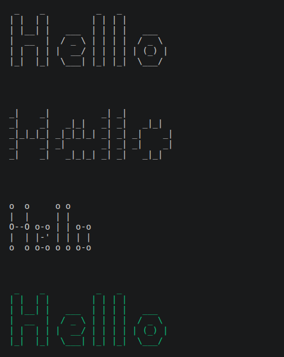

# ASCII Art Web

A Go program that takes a string and prints it as ASCII art in the terminal, using different banner styles.

## Features

- Converts text into ASCII art
- Supports printable ASCII characters (from 32 to 126)
- `\n` is not printed literally: it creates a line break
- Three banner styles: `standard`, `shadow`, `thinkertoy`
- Options that can be combined:
  - `--output`: writes the result to a file instead of the terminal
  - `--color`: prints the result in color (the whole text, or only a chosen part)

## Requirements

- Go 1.22.2 or later

## Usage

```bash
go run . [--output=<file>] [--color=<color>] [substring] <text> [banner]
```

The order of the arguments matters:

1. `--output=<file>` (optional)
2. `--color=<color>` (optional)
3. `substring`: the part of the text to color (optional, only with `--color`)
4. `text`: the text to convert
5. `banner`: `standard`, `shadow` or `thinkertoy`

All options can be used together.

### Banners

| Banner       | Description                |
|--------------|----------------------------|
| `standard`   | Default style              |
| `shadow`     | Style with a shadow effect |
| `thinkertoy` | Thinkertoy style           |

### Option: `--output`

Writes the result into a file instead of the terminal.

```bash
go run . --output=result.txt "Hello" standard
```

### Option: `--color`

Available colors: `red`, `green`, `yellow`, `blue`, `magenta`, `cyan`, `white`, `black`.

Color the whole text:

```bash
go run . --color=red "Hello" standard
```

Color only a part of the text:

```bash
go run . --color=blue "llo" "Hello" standard
```

Here only the letters "llo" are colored.

### Combining options

```bash
go run . --output=result.txt --color=blue "llo" "Hello" standard
```

## Examples

```bash
go run . "Hello" standard
go run . "Hello" shadow
go run . "Hello" thinkertoy
go run . --color=green "Hello" standard
go run . --output=result.txt --color=cyan "llo" "Hello" standard
```

## Preview



## Project structure

```
.
├── fichier.txt
├── go.mod
├── main.go
├── README.md
├── shadow.txt
├── standard.txt
├── thinkertoy.txt
└── tools
    ├── cara.go
    ├── color.go
    ├── formatage.go
    └── utils.go
```

## Author

swannsavary